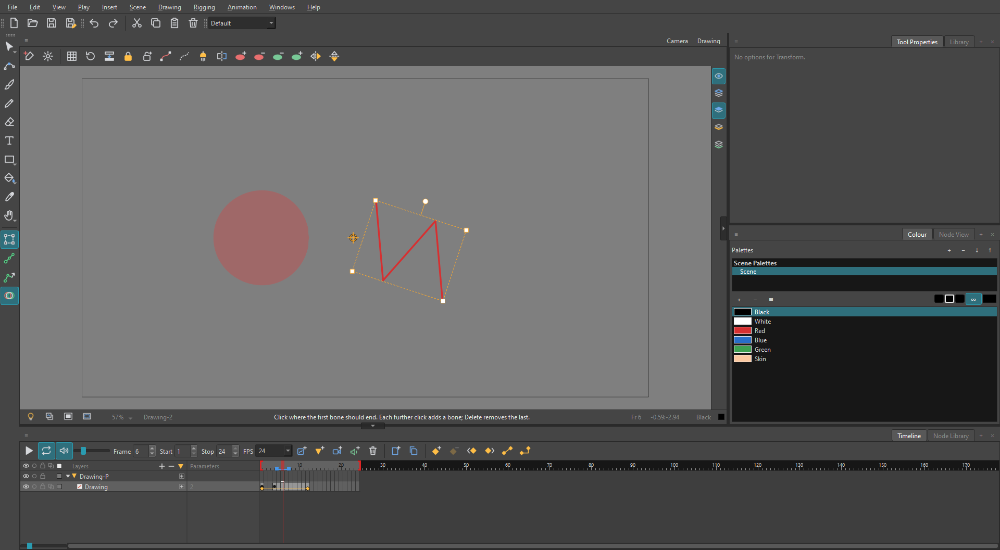
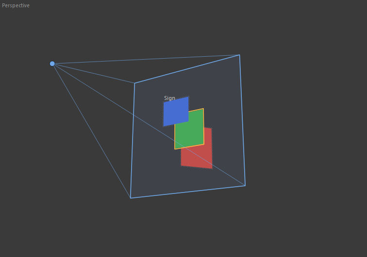
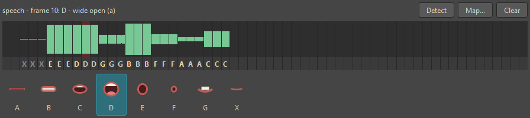
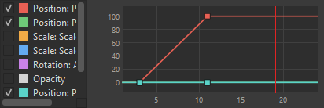

# Eclipse

Eclipse is a 2D animation program for Windows, written in C++ with Qt 6. It is for
hand-drawn and cut-out animation: you draw with vector tools on layers, time the drawings
on a timeline or an exposure sheet, move and bend them with pegs and deformers, and export
the result as a movie or as pictures.

Its layout and way of working follow the conventions of professional animation software,
so the views, menus and shortcuts will feel familiar if you have used one. All of the
code and all of the icons are Eclipse's own.



Eclipse is under active development. Expect rough edges.

## What it does

**Drawing**

- Brush, pencil, eraser, line, rectangle, ellipse and polyline tools; a paint bucket with
  several modes and an ink tool; a text tool; a cutter; a dropper; a stamp; perspective and
  envelope tools to reshape a selection; pencil and smooth editors; a tool that repositions
  every drawing of a layer at once.
- Vector artwork: lines keep their points and can be reshaped with the Contour Editor.
- Four art layers in every drawing: overlay, line art, colour art and underlay.
- Colour palettes whose colours are linked to the artwork (change a colour and everything
  painted with it changes), including gradients; palettes can be linked to a file shared
  between scenes.
- Guides to draw along: rulers, grids, 1-, 2- and 3-point perspective, and a symmetry axis
  that mirrors what you draw.
- Clean-up commands: remove dirt and stray lines, close gaps, unpaint or repaint a
  selection; protected colours that the paint tools leave alone.
- Onion skin, light table, grids, alignment guides, and a rotating, mirrorable view.

**Animating**

- A Timeline and an Xsheet, with exposure commands (extend, hold, fill, cycle, sequence);
  drawings can be named and typed into the Xsheet.
- Keyframes with ease, motion and stop-motion keyframes, and a Function view of the curves;
  position, scale, rotation, skew, depth and opacity are all animated.
- Drawings marked as keys, breakdowns and in-betweens; frames marked with colours; tagged
  layers.
- Pegs, layer hierarchies, bones, curve and envelope deformers, and inverse kinematics.
- Morphing between two drawings.
- Depth: layers nearer to and further from the camera, several cameras, and Top, Side and
  Perspective views.
- Sound layers, sound scrubbing, and lip-sync detection that can be mapped onto mouth drawings.

**Views**

Camera, Drawing, Timeline, Xsheet, Tool Properties, Layer Properties, Colour, Library,
Node View, Node Library, Function, Onion Skin, Drawing Substitution, Top, Side,
Perspective, Lip-Sync, Scene Markers, Guides, Metadata, Reference, Message Log and more.
Views can be dragged, tabbed together, floated, and saved as workspaces.

| | |
|---|---|
|  |  |
| Layers standing at different depths in front of the camera | Mouth shapes detected in a sound, frame by frame |



**Files**

- Scenes are saved as `.ecl` files.
- Imports pictures, movies and sound; exports movies, picture sequences and animated GIFs.
  Movies and some sound formats are read and written through [FFmpeg](https://ffmpeg.org/),
  which has to be installed and on the `PATH` for those features.
- Templates can be kept in a Library and dropped into other scenes.
- Help pages are built in (Help > Eclipse Help, F1).

## Building

Eclipse builds on Windows with the Microsoft compiler.

### What you need

| | |
|---|---|
| **Visual Studio 2022 or later** | with the "Desktop development with C++" workload |
| **CMake 3.21 or later** | and **Ninja** (both come with Visual Studio) |
| **Qt 6** (built and tested with 6.8) | the MSVC 64-bit kit; the modules used are Core, Gui, Widgets, Svg and PrintSupport |

### The quick way

From the folder you cloned into:

```bat
build.bat
```

The script finds Visual Studio by itself and looks for Qt under `C:\Qt`. If your Qt is
somewhere else, say where before you run it:

```bat
set QT_ROOT=D:\Qt\6.8.3\msvc2022_64
build.bat
```

The program is built into `out\`. Run `out\Eclipse.exe`.

To make a folder you can copy to another computer (the program, its resources, and the Qt
files it needs):

```bat
package.bat
```

That writes a `Release` folder.

### By hand with CMake

Open an "x64 Native Tools Command Prompt for VS", then:

```bat
cmake -S . -B out -G Ninja -DCMAKE_BUILD_TYPE=Release -DCMAKE_PREFIX_PATH=C:\Qt\6.8.3\msvc2022_64
cmake --build out
C:\Qt\6.8.3\msvc2022_64\bin\windeployqt.exe --no-translations out\Eclipse.exe out\EclipseUi.dll out\EclipseActions.dll out\EclipseAudio.dll out\EclipseModel.dll
```

Replace the Qt path with yours. The last line copies the Qt files next to the program and
only has to be run once.

## How the code is laid out

Eclipse is four libraries and a small program that starts them. Each folder under `src`
is one module:

| Module | Folder | What is in it |
|---|---|---|
| `EclipseModel.dll` | `src/model` | The scene: layers, drawings, keyframes, and every change to them as a step that can be undone |
| `EclipseAudio.dll` | `src/audio` | Reading, mixing and playing sound; lip-sync detection |
| `EclipseActions.dll` | `src/actions` | Menus, toolbars and shortcuts, and the look of the program |
| `EclipseUi.dll` | `src/ui` | The main window and all of its views |
| `Eclipse.exe` | `src/app` | Starts the window |

The menus, toolbars, keyboard shortcuts and icons are not compiled in. They are read when
the program starts from the `resources` folder beside it (`menus.xml`, `toolbars.xml`,
`shortcuts.xml`, and `icons/`), so they can be changed without rebuilding.

## Platform

Windows 10 or later, 64-bit. Sound playback uses the Windows multimedia API, so the
program does not build on other systems as it stands.

## Licence

Eclipse is free to use, change and share, including in commercial work, under the
[zlib licence](LICENSE). The one thing you may not do is pass it off as your own: you
must not claim you wrote the original, changed versions must be marked as changed, and
the licence notice stays with the source.
