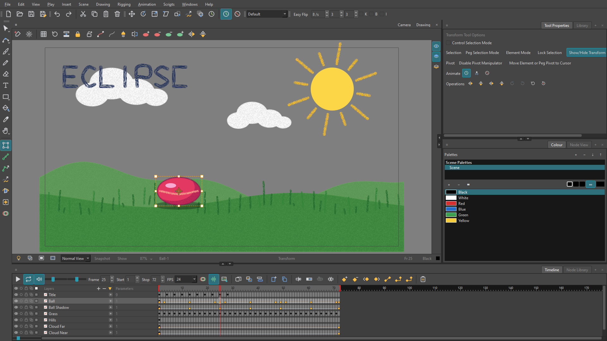
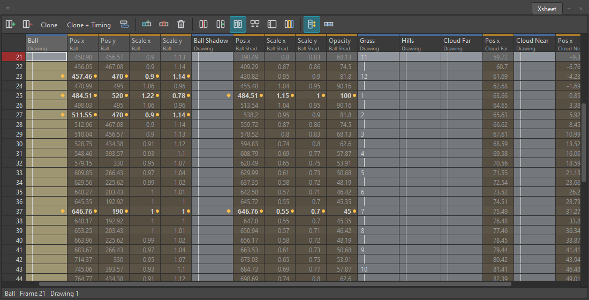
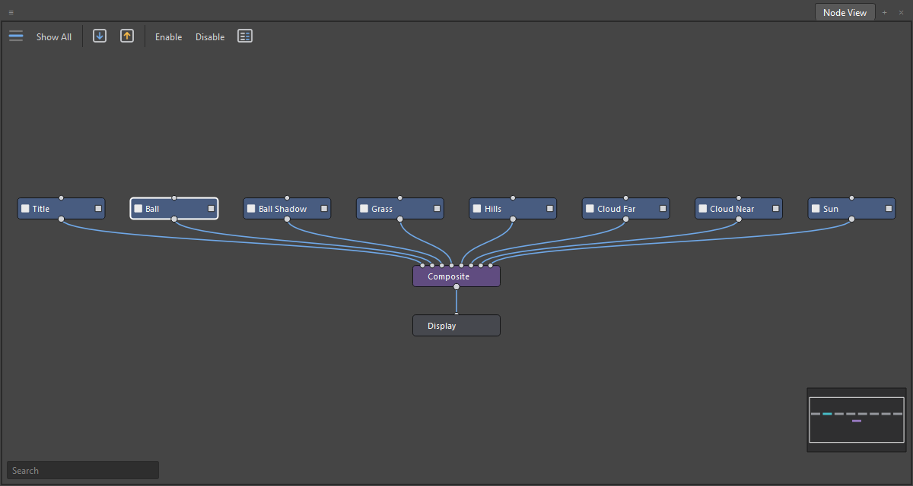
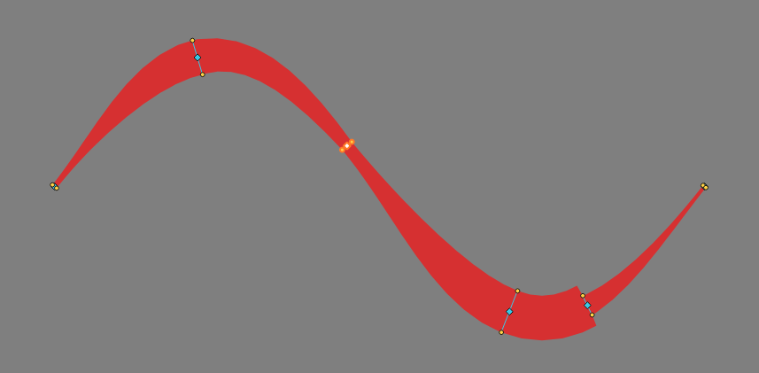
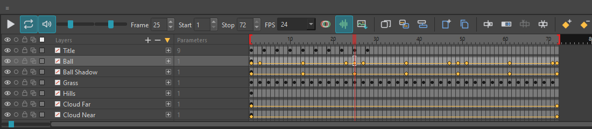

<div align="center">

# Eclipse

**A 2D animation program for Windows — hand-drawn and cut-out, from the first sketch to the finished movie.**

[](https://github.com/MeyouVA/Eclipse/releases)
&nbsp;

&nbsp;

&nbsp;
[](LICENSE)


<sub>A short demo scene, drawn, timed and rendered in Eclipse.</sub>

</div>


> **Early days.** Eclipse is under active development. Expect rough edges, and please report what you find.

---

## ⬇️ Get it

1. Download the latest build from the **[Releases page](https://github.com/MeyouVA/Eclipse/releases)**.
2. Unzip it anywhere.
3. Run `Eclipse.exe`. Nothing has to be installed.

Movies, extra image formats, USD files and the Python console use the bundled tools in `thirdparty/` — they come with the release.

---

## ✨ Highlights

<table>
<tr>
<td width="50%" valign="top">

### ✏️ Draw
Vector brush, pencil, shapes, text, paint bucket and more. Lines keep their points, so you can reshape them later. Four art layers in every drawing, linked colour palettes with gradients and picture textures, guides, onion skin and a light table.

</td>
<td width="50%" valign="top">

### 🎞️ Time it
A **Timeline** and an **Xsheet** side by side, with exposure commands (hold, extend, fill, cycle, sequence). Drawings can be named and typed straight into the sheet.

</td>
</tr>
<tr>
<td colspan="2"></td>
</tr>
<tr>
<td width="50%" valign="top">

### 🦴 Animate
Pegs, bones, deformers, inverse kinematics, morphing and pose controllers — plus **Master Controllers**, whose own scripts put sliders and pads in the Camera view.

</td>
<td width="50%" valign="top">

### 📈 Shape the motion
Every value has a curve in the **Function** view: ease, linear, held — edited point by point.

</td>
</tr>
<tr>
<td></td>
<td></td>
</tr>
<tr>
<td width="50%" valign="top">

### 🧩 Composite
Over forty animatable effects (blur, glow, shadow, particles, colour, mattes…) and a **Node View** for wiring layers, effects and composites by hand.

</td>
<td width="50%" valign="top">

### 🖊️ Fine-tune your lines
The **Pencil Editor** puts thickness points on a line: click to add one, type a number to size it, pick how it blends into the next.

</td>
</tr>
<tr>
<td></td>
<td></td>
</tr>
<tr>
<td width="50%" valign="top">

### 🎥 Work in depth
Layers at different distances from the camera, several cameras, and Top, Side and **Perspective** views.

</td>
<td width="50%" valign="top">

### 🔊 Sound and lip-sync
Sound layers with scrubbing, a sound element editor, and lip-sync detected from the sound or the words.

</td>
</tr>
<tr>
<td></td>
<td></td>
</tr>
</table>

<p align="center"></p>

---

## 📦 Files in and out

| | |
|---|---|
| **Scenes** | Saved as `.ecl` |
| **Movies out** | MP4, MOV, AVI, MKV, WebM, GIF and more, with ProRes, DNxHD and transparent formats |
| **Pictures** | PNG, JPEG, TIFF, layered PSD, EXR, WebP, HEIC, AVIF and dozens more, in and out |
| **Animation** | Maya ATOM and USD (`.usda`, `.usdc`, `.usdz`) keyframes, in and out |
| **Flash** | SWF in and out; FLA documents in, as a rig or frame by frame |
| **Also in** | Sound, movies, 3D models (OBJ), SVG and PDF artwork, scanners, editing timelines (EDL, Final Cut XML, OpenTimelineIO) |

<details>
<summary><b>The full list of what Eclipse can do</b></summary>

#### Drawing
- Brush, pencil, eraser, line, rectangle, ellipse and polyline tools; paint bucket and ink tool; text, cutter, dropper and stamp tools.
- Perspective and envelope tools to reshape a selection; pencil and smooth editors; a tool that repositions every drawing of a layer at once.
- Overlay, line art, colour art and underlay layers in every drawing.
- Palettes linked to the artwork (change a colour and everything painted with it changes), gradients, picture textures (placed and scaled with the Edit Gradient tool), palettes shared between scenes.
- Guides: rulers, grids, 1-, 2- and 3-point perspective, and a symmetry axis.
- Clean-up: remove dirt and stray lines, close gaps, protected colours.

#### Animating
- Keyframes with ease, motion and stop-motion keys; position, scale, rotation, skew, depth and opacity all animate.
- Key, breakdown and in-between drawings; coloured frame marks; tagged layers.
- Pegs, layer hierarchies, bones, curve, envelope and point deformers, glue at the joints, and inverse kinematics.
- Morphing guided by hints.
- Pose and Master Controllers; split positions; constraints and springs.
- 3D models on layers of their own, turned in space with the layer.

#### Sound and playback
- Sound layers, scrubbing, clips, loops, gain envelopes and audio effects.
- Lip-sync from the sound or from typed words, mapped onto mouth drawings.
- Forward and backward playback with ranges and speeds; a Playback Viewer for picture sequences and movies.

#### Effects and scripting
- Blurs, colour corrections, glow, shadow, bloom, particles, mattes, cutters and field charts — each animatable.
- Script (JavaScript run on the picture) and External (any program run on it) effects.
- A Script Editor (JavaScript) and a Python console that work on the scene.

#### Command-line programs
- `eclipse-batch` renders and runs scripts without the window; `eclipse-convert`, `eclipse-info`, `eclipse-config` and `eclipse-services` handle files, settings and render queues.

#### Help
- Built-in help pages (Help > Eclipse Help, F1) and context help for every view.

</details>

---

## 🛠️ Building from source

You need **Visual Studio 2022+** (Desktop development with C++), **CMake 3.21+** with **Ninja**, and **Qt 6.8** (MSVC 64-bit).

```bat
build.bat
```

The program is built into `out\`. Run `out\Eclipse.exe`.

If Qt is not under `C:\Qt`, say where first:

```bat
set QT_ROOT=D:\Qt\6.8.3\msvc2022_64
build.bat
```

To make a folder you can copy to another computer:

```bat
package.bat
```

<details>
<summary><b>Third-party tools (FFmpeg, ImageMagick, Python, USD)</b></summary>

The pinned list is in `scripts/thirdparty.json`. Preview it without downloading anything:

```bat
scripts\install_thirdparty.bat
```

Then install:

```bat
scripts\install_thirdparty.bat -Install
```

- Every download is checked against its size and SHA-256 before it is unpacked.
- Packages go into the ignored `thirdparty/` folder, with their licences gathered in `thirdparty/LICENSES.md`.
- `package.bat` copies what the program needs at run time into `Release/thirdparty`.
- On ARM64 Windows, packages built only for x64 (USD) are left out.

</details>

<details>
<summary><b>Building by hand with CMake</b></summary>

From an "x64 Native Tools Command Prompt for VS":

```bat
cmake -S . -B out -G Ninja -DCMAKE_BUILD_TYPE=Release -DCMAKE_PREFIX_PATH=C:\Qt\6.8.3\msvc2022_64
cmake --build out
```

Then run `windeployqt` once on `out\Eclipse.exe` and its DLLs to copy the Qt files beside them.

</details>

---

## 🗂️ How the code is laid out

| Module | Folder | What's in it |
|---|---|---|
| `EclipseColour` | `src/colour` | Colour spaces, OpenColorIO, LUTs and ICC profiles |
| `EclipseModel` | `src/model` | The scene: layers, drawings, keyframes, and undoable changes |
| `EclipseAudio` | `src/audio` | Reading, mixing and playing sound; lip-sync |
| `EclipseFormats` | `src/formats` | Other programs' files: Flash, ATOM, USD, zip |
| `EclipseRender` | `src/render` | Rendering and layer effects |
| `EclipseActions` | `src/actions` | Menus, toolbars, shortcuts and the look |
| `EclipseCanvas` | `src/canvas` | The Camera and Drawing views and their tools |
| `EclipseUi` | `src/animation/ui` | The Animation main window and its views |
| `EclipseBoardModel` | `src/board/model` | Project files for the Storyboard app |
| `EclipseBoardUi` | `src/board/ui` | The Storyboard main window |
| `EclipseLauncher` | `src/launcher` | The shared Welcome window |
| `Eclipse.exe` | `src/app` | Starts the chosen app (plus entry points for the command-line programs) |

Menus, toolbars, shortcuts and icons live in `resources/` and are read at start-up, so they can be changed without rebuilding.

---

## 📄 Licence

Eclipse is free to use, change and share — including in commercial work — under the [zlib licence](LICENSE). Just don't claim you wrote the original, and mark changed versions as changed.
