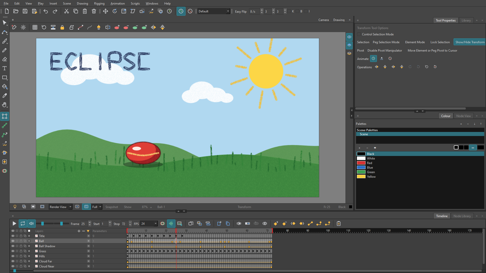
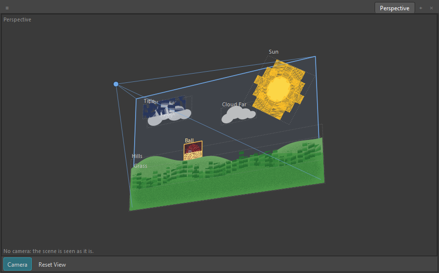
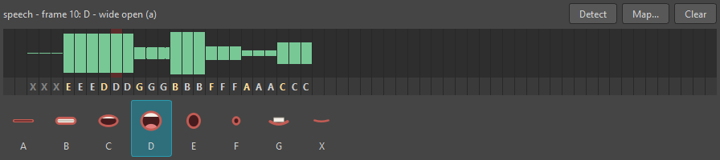
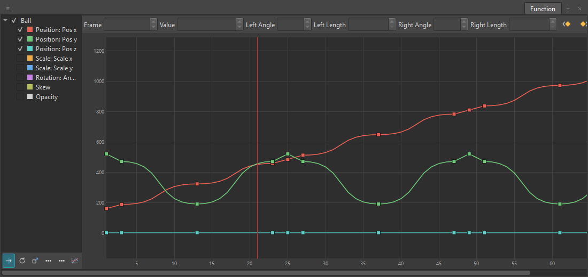

# Eclipse

Eclipse is a 2D animation program for Windows, written in C++ with Qt 6. It is for
hand-drawn and cut-out animation: you draw with vector tools on layers, time the drawings
on a timeline or an exposure sheet, move and bend them with pegs and deformers, and export
the result as a movie or as pictures.

Its layout and way of working follow the conventions of professional animation software,
so the views, menus and shortcuts will feel familiar if you have used one. All of the
code and all of the icons are Eclipse's own.



Eclipse is under active development. Expect rough edges.

**Download:** the latest build is on the [Releases page](https://github.com/MeyouVA/Eclipse/releases) - unzip it
anywhere and run `Eclipse.exe`. Nothing has to be installed (FFmpeg is needed only for movies; see below).

## What it does

**Drawing**

- Brush, pencil, eraser, line, rectangle, ellipse and polyline tools; a paint bucket with
  several modes and an ink tool; a text tool; a cutter; a dropper; a stamp; perspective and
  envelope tools to reshape a selection; pencil and smooth editors; a tool that repositions
  every drawing of a layer at once.
- Vector artwork: lines keep their points and can be reshaped with the Contour Editor.
- Four art layers in every drawing: overlay, line art, colour art and underlay.
- Colour palettes whose colours are linked to the artwork (change a colour and everything
  painted with it changes), including gradients; palettes can be linked to a file shared
  between scenes.
- Guides to draw along: rulers, grids, 1-, 2- and 3-point perspective, and a symmetry axis
  that mirrors what you draw.
- Clean-up commands: remove dirt and stray lines, close gaps, unpaint or repaint a
  selection; protected colours that the paint tools leave alone.
- Onion skin, light table, grids, alignment guides, and a rotating, mirrorable view.

**Animating**

- A Timeline and an Xsheet, with exposure commands (extend, hold, fill, cycle, sequence);
  drawings can be named and typed into the Xsheet.
- Keyframes with ease, motion and stop-motion keyframes, and a Function view of the curves;
  position, scale, rotation, skew, depth and opacity are all animated.
- Drawings marked as keys, breakdowns and in-betweens; frames marked with colours; tagged
  layers.
- Pegs, layer hierarchies, bones, curve and envelope deformers, and inverse kinematics.
- Morphing between two drawings, guided by hints and by groups of shapes that only change into each other.
- Pose controllers: poses of several layers kept under names, blended with a slider or a 2D pad, and keyframed.
- 3D models (Wavefront OBJ, with their colours and textures) on layers of their own, turned in space with the layer.
- Depth: layers nearer to and further from the camera, several cameras, and Top, Side and
  Perspective views.
- Sound layers, sound scrubbing, and lip-sync detection - from the sound, or from the words typed - that can be mapped
  onto mouth drawings.
- Sound Element Editor for clips, loops, gain envelopes and ordered audio effects, including filters, echo,
  reverb, pitch and tempo. Sound files are collected into the scene folder when saving. Preferences control
  sound-column visibility/colour and analog scrubbing; tempo markers have a starting frame.

**Effects and compositing**

- Over forty effects on a layer, each one animatable: blurs (directional, radial, variable, motion, depth of field),
  colour (tint, curves, hue-saturation, brightness-contrast, gradients), glow, shadow, bloom, particles, mattes and
  cutters, field charts - and Script (JavaScript run on the picture) and External (any program run on it).
- A node graph: wire layers, effects, composites and groups together by hand in the Node View, and the frame is made as
  the graph says.
- Scripting: a Script Editor (JavaScript) and a Python console that work on the scene.

**Views**

Camera, Drawing, Timeline, Xsheet, Tool Properties, Layer Properties, Colour, Library,
Node View, Node Library, Function, Onion Skin, Drawing Substitution, Top, Side,
Perspective, Lip-Sync, Scene Markers, Guides, Metadata, Reference, Message Log and more.
Views can be dragged, tabbed together, floated, and saved as workspaces.

| | |
|---|---|
|  |  |
| Layers standing at different depths in front of the camera | Mouth shapes detected in a sound, frame by frame |



**Files**

- Scenes are saved as `.ecl` files.
- Imports pictures, movies, sound, 3D models (OBJ), pages from a scanner, Flash movies (SWF) and Flash documents
  (FLA, the XFL kind of Flash CS5 and after: symbols, tweens, masks, text, bitmaps, video and sound come across).
  A Flash movie can come in as a rig - a drawing layer on a peg for each depth of it, its motion as keyframes - or
  frame by frame on one layer; as layers it can also go into the Library as a template.
- Exports movies, picture sequences, animated GIFs and Flash movies (SWF): each drawing written once and moved
  frame by frame, with gradients, pictures, lines, sound, opacity, tints, blurs, glows, shadows, blend modes and
  cutters (as masks); and a report of anything Flash has no like of.
  Movies and sound formats use the bundled [FFmpeg](https://ffmpeg.org/) tools in `thirdparty/`,
  installed with the script below; no FFmpeg entry on `PATH` is needed.
- Image import and export share one format registry, including PNG, JPEG, TIFF, layered PSD, EXR,
  GIF, WebP, APNG, HEIC/HEIF, AVIF, JPEG 2000, JPEG XL, QOI, DDS, icons and portable image formats.
  Animated GIF, WebP and APNG import as drawings with exposure timing. Camera RAW is read-only.
  Profiles, alpha and high-depth pixels are retained where their file format supports them.
  SVG import can keep the picture or convert its paths into editable strokes and fills, with native
  curve handles and supported gradients. Raster effects and embedded bitmaps require picture import.
  ICNS import also reads classic masked, indexed, planar RLE, ARGB and JPEG 2000 icon elements.
  Additional picture formats include PAM/PNM, Farbfeld, MIFF, MNG, JNG, JPEG-LS, VBN, XWD,
  X-Face, Sun Raster, VIFF, PICT, DCX, FITS, VICAR, Cineon, MATLAB images, Palm, OTB, HRZ,
  MTV, IPL, CALS and SIXEL. Photo CD, WPG, DICOM and compressed SVG are import-only.
  X-Face requires 48 by 48 pixels and HRZ requires 256 by 240. Headerless pixel/audio/video
  streams need their encoding parameters and are not covered by automatic format detection.
- Movie export offers MP4, MOV, AVI, MKV, WebM, M4V, MPEG, WMV, FLV, OGV and MXF, with codec choices
  appropriate to each container. ProRes 4444, PNG, Animation, uncompressed and WebM exports can keep
  transparency in compatible containers. DNxHD uses 1920 by 1080 frames; DNxHR accepts other sizes.
  The scene's audible tracks are mixed into movies. Picture sequences can also be kept separately.
  Additional movie exports include NUT, MPEG transport streams, 3GP/3G2, ASF and silent YUV4MPEG.
  AVI and NUT offer lossless FFV1 and HuffYUV with alpha. Import also lists additional legacy
  and elementary movie streams handled by the bundled decoder; available subtypes vary by codec.
- Audio export offers WAV, AIFF, MP3, AAC/M4A, Vorbis, Opus, FLAC, ALAC, WMA and AC-3, with sample
  rate and mono/stereo choices. WAV and AIFF support 8/16/24/32-bit integer and 32-bit float files.
  Export all frames or a selected range, mixed or as separate sound tracks. Audio decoding, effects
  and mixing use 64-bit floating-point samples at the export rate, up to 192 kHz for lossless audio.
  Playback previews use 16-bit stereo at 44100 Hz; movies receive a precise 48 kHz mix.
  Additional audio exports include AU, CAF, Wave64, SoX native, True Audio, WavPack, MP2 and
  Enhanced AC-3. Import lists additional compressed, tracker and legacy sound families; this
  does not guarantee every historical encoding within a container can be decoded.
- Templates can be kept in a Library and dropped into other scenes.
- Help pages are built in (Help > Eclipse Help, F1).

## Building

Eclipse builds on Windows with the Microsoft compiler.

### What you need

| | |
|---|---|
| **Visual Studio 2022 or later** | with the "Desktop development with C++" workload |
| **CMake 3.21 or later** | and **Ninja** (both come with Visual Studio) |
| **Qt 6** (built and tested with 6.8) | the MSVC 64-bit kit; the modules used are Core, Gui, Widgets, Svg, PrintSupport and Qml |

### The quick way

From the folder you cloned into:

```bat
build.bat
```

The script finds Visual Studio by itself and looks for Qt under `C:\Qt`. If your Qt is
somewhere else, say where before you run it:

```bat
set QT_ROOT=D:\Qt\6.8.3\msvc2022_64
build.bat
```

The program is built into `out\`. Run `out\Eclipse.exe`.

To make a folder you can copy to another computer (the program, its resources, and the Qt
files it needs):

```bat
package.bat
```

That writes a `Release` folder.

### By hand with CMake

Open an "x64 Native Tools Command Prompt for VS", then:

```bat
cmake -S . -B out -G Ninja -DCMAKE_BUILD_TYPE=Release -DCMAKE_PREFIX_PATH=C:\Qt\6.8.3\msvc2022_64
cmake --build out
C:\Qt\6.8.3\msvc2022_64\bin\windeployqt.exe --no-translations out\Eclipse.exe out\EclipseUi.dll out\EclipseCanvas.dll out\EclipseActions.dll out\EclipseFormats.dll out\EclipseRender.dll out\EclipseAudio.dll out\EclipseModel.dll out\EclipseColour.dll
```

Replace the Qt path with yours. The last line copies the Qt files next to the program and
only has to be run once.

## Local third-party packages

The pinned download plan is in `scripts/thirdparty.json`. Preview it without downloading:

```bat
scripts\install_thirdparty.bat
```

After reviewing and approving the packages, install them with:

```bat
scripts\install_thirdparty.bat -Install
```

The installer checks archive sizes and SHA-256 hashes before extraction, verifies existing
installations before skipping them, and fails rather than replacing an unknown installation.
It detects the native Windows CPU architecture even from an emulated shell. Intel and AMD
64-bit CPUs use the same x64 packages; ARM64 uses pinned native ARM64 packages. Unsupported
architectures fail clearly. Preview another target without downloading with
`scripts\install_thirdparty.bat -Architecture arm64`; use `-Install` only after reviewing
and approving that target's download list. Existing packages of another architecture are
never silently replaced. Package selection does not change the Qt/MSVC build target.
Packages and their original notices stay in the ignored `thirdparty/` directory; the installer
also writes `thirdparty/LICENSES.md`. The FFmpeg package in this initial plan is a GPL build
to provide software H.264 and HEVC encoders. Its notices and those of its bundled codecs must
be retained. ImageMagick delegates and Python bundled components have their own notices too.

The installer uses an existing 7-Zip installation for `.7z` packages and Windows `tar` for ZIP
packages. It does not download an extractor automatically. FFmpeg is found only in the bundled
packages, independent of PATH. The Python console prefers the bundled interpreter. Packaging
copies runtime executables, DLLs, configuration and original notices into `Release/thirdparty`;
download archives, development headers and import libraries are left out.

The build checks `thirdparty/qt` before `QT_ROOT` or the usual `C:/Qt`
installation, and CMake searches `thirdparty` first. Qt 6 for MSVC is currently installed
separately. No Qt SDK download is included in this plan.

## How the code is laid out

Eclipse is eight libraries and a small program that starts them. Each folder under `src`
is one module:

| Module | Folder | What is in it |
|---|---|---|
| `EclipseColour.dll` | `src/colour` | Colour management: colour spaces, OpenColorIO configurations, look-up tables and ICC profiles |
| `EclipseModel.dll` | `src/model` | The scene: layers, drawings, keyframes, and every change to them as a step that can be undone |
| `EclipseAudio.dll` | `src/audio` | Reading, mixing and playing sound; lip-sync detection |
| `EclipseFormats.dll` | `src/formats` | Other programs' files: Flash `.fla` and `.swf` in, `.swf` out, Flash video, zip archives |
| `EclipseRender.dll` | `src/render` | Pictures of the scene without the window: what layer effects do to a picture |
| `EclipseActions.dll` | `src/actions` | Menus, toolbars and shortcuts, and the look of the program |
| `EclipseCanvas.dll` | `src/canvas` | The Camera and Drawing views and all their tools |
| `EclipseUi.dll` | `src/ui` | The main window and all of its views |
| `Eclipse.exe` | `src/app` | Starts the window |

The menus, toolbars, keyboard shortcuts and icons are not compiled in. They are read when
the program starts from the `resources` folder beside it (`menus.xml`, `toolbars.xml`,
`shortcuts.xml`, and `icons/`), so they can be changed without rebuilding.

## Platform

Windows 10 or later, 64-bit. Sound playback uses the Windows multimedia API, so the
program does not build on other systems as it stands.

## Licence

Eclipse is free to use, change and share, including in commercial work, under the
[zlib licence](LICENSE). The one thing you may not do is pass it off as your own: you
must not claim you wrote the original, changed versions must be marked as changed, and
the licence notice stays with the source.
